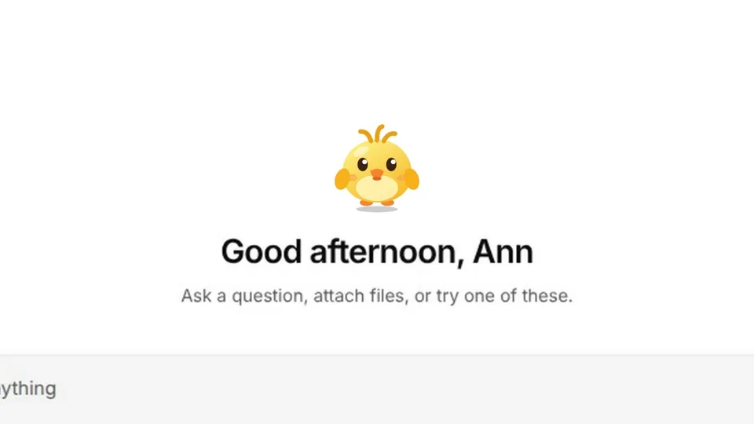
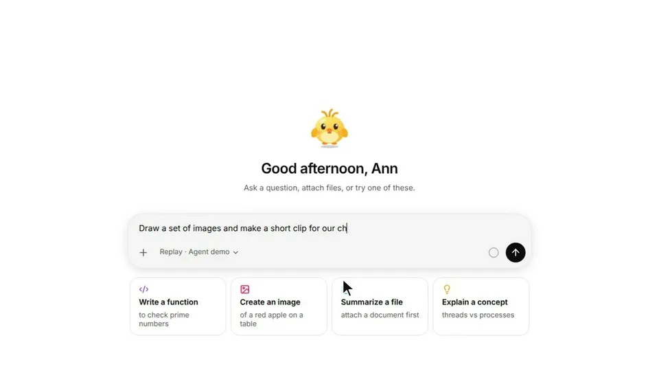
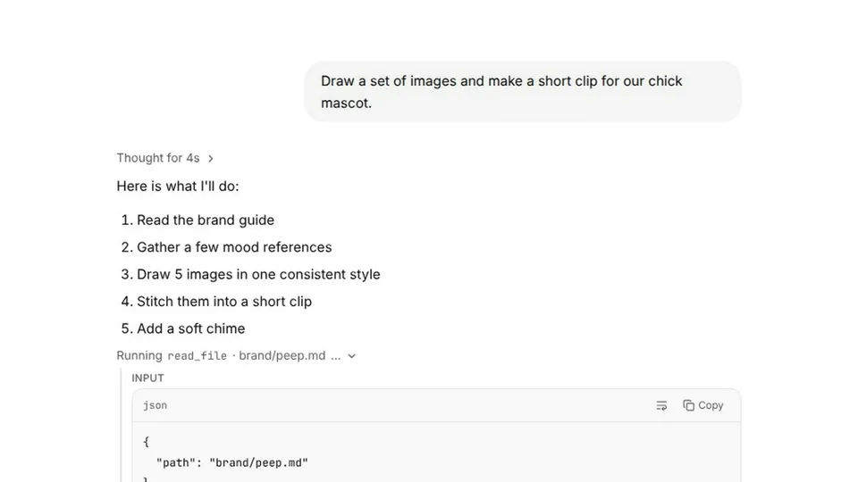
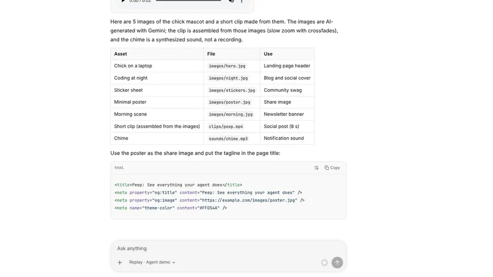
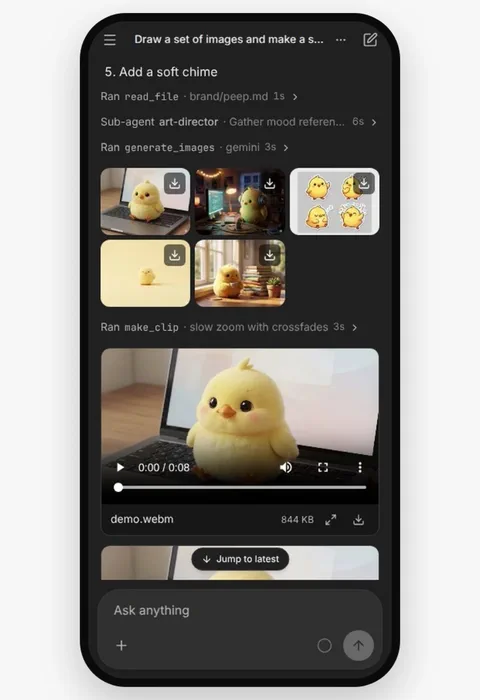
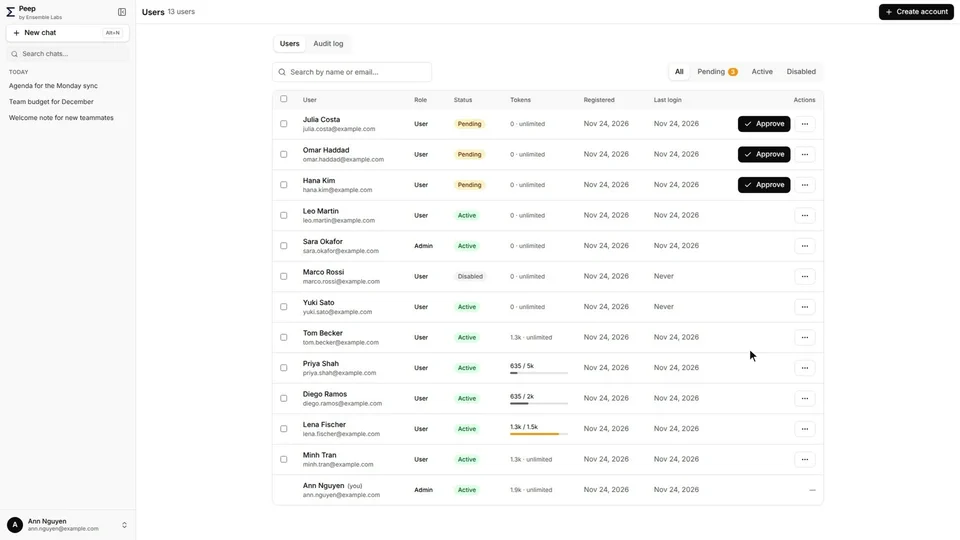
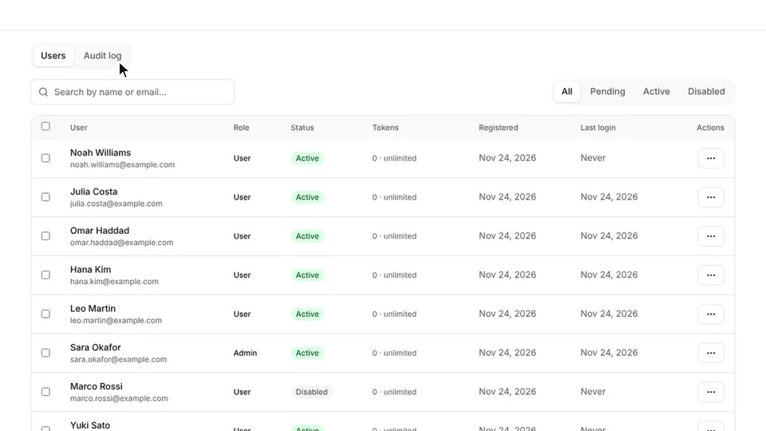
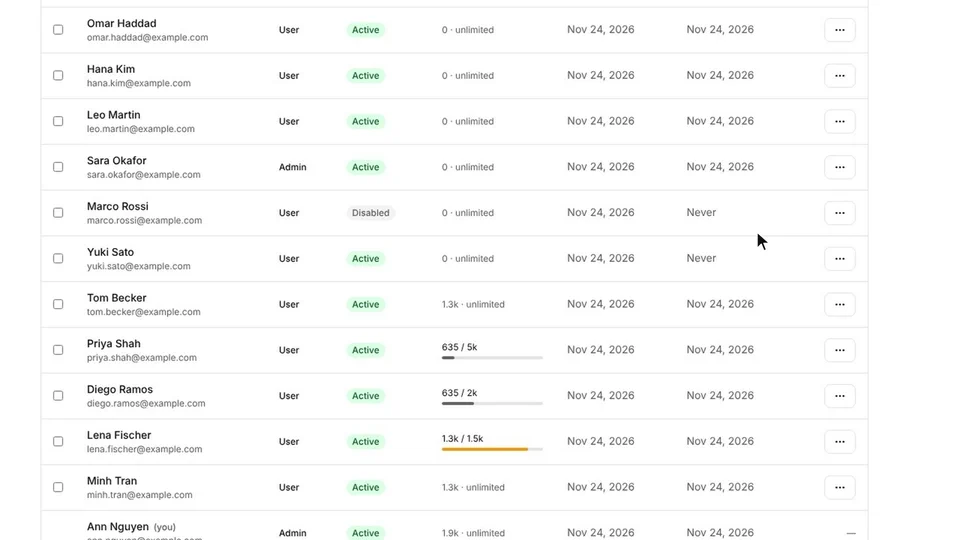
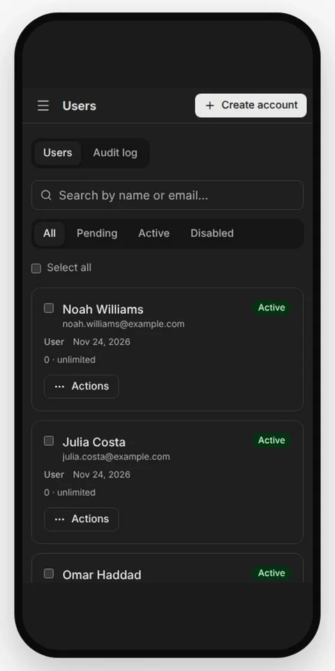

<p align="center">English | <a href="README.vi.md">Tiếng Việt</a></p>

<p align="center"></p>

<h1 align="center">Peep</h1>

<p align="center">&nbsp;<sub>by Ensemble Labs</sub></p>

<p align="center">A ChatGPT-style web UI for AI agents: watch them think, call tools and make things, live.</p>

<p align="center"><a href="LICENSE"></a> <a href="https://github.com/ensemlabs/peep/actions/workflows/ci.yml"></a></p>

<p align="center"></p>

<p align="center"><sub><i>One agent run, live: thinking, a plan, tools, a sub-agent and generated images. Demo media were made with Gemini.</i></sub></p>

## See it in action

<table>
<tr>
<td width="50%" valign="top"><br><b>Peep says hello</b><br><sub>A new chat greets you, then Peep keeps you company.</sub></td>
<td width="50%" valign="top"><br><b>Live thinking</b><br><sub>Reasoning streams in, then folds away.</sub></td>
</tr>
<tr>
<td width="50%" valign="top"><br><b>Tools, sub-agents, images</b><br><sub>Every step of the run, then the results.</sub></td>
<td width="50%" valign="top"><br><b>Lightbox and video</b><br><sub>Zoom in, play, scrub, download.</sub></td>
</tr>
<tr>
<td width="50%" valign="top"><br><b>Context ring</b><br><sub>See what fills the context window.</sub></td>
<td width="50%" valign="top"><br><b>Status at a glance, light or dark</b><br><sub>Running, unread and failed chats; one click to dark.</sub></td>
</tr>
<tr>
<td align="center" valign="top"><br><b>On your phone</b><br><sub>Same experience on mobile.</sub></td>
<td align="center" valign="top"><br><b>Gallery and drawer on mobile</b><br><sub>Tap, swipe, and switch chats.</sub></td>
</tr>
</table>

## Account management

Peep has real accounts for a team, with an admin console to run them. Admins approve people who sign up, or create
accounts themselves and hand over a temporary password, then manage everyone from one page that also works on a
phone. Every admin change is written to an audit log, and each user can get a token limit. The full guide is in
[docs/usage.md](docs/usage.md#account-management).

- Create accounts (active at once, or pending), and approve, disable, enable or delete many at a time. Your own
  account is skipped.
- Make or remove admins, reset passwords, disable a user (sessions end, data stays) or delete one with their files.
- Set a token limit per user, per day or per month (UTC), checked before a message is sent. Unlimited by default.
- Users see their usage in the account menu; at the limit, the composer says when it resets.
- An audit log tab shows who did what to whom, with search and an action filter.

<table>
<tr>
<td width="50%" valign="top"><br><b>Create and approve</b><br><sub>Make an account, approve a batch.</sub></td>
<td width="50%" valign="top"><br><b>Audit log</b><br><sub>Who changed what, and when.</sub></td>
</tr>
<tr>
<td width="50%" valign="top"><br><b>Token limits</b><br><sub>Set a limit; the user is blocked at the cap.</sub></td>
<td align="center" valign="top"><br><b>Admin on a phone</b><br><sub>The same console on mobile.</sub></td>
</tr>
</table>

## What is Peep

Peep is a self-hosted chat web app that shows the whole run of an AI agent, not only its final answer: thinking, tool
calls, sub-agents, images, video, audio and how much of the context window is used, all streaming live. It works with
any OpenAI-compatible chat API (OpenAI, Gemini, DeepSeek, Anthropic compat, OpenRouter, vLLM, Ollama and others).
Peep is a UI: it has no agent logic of its own yet, and ships recorded demo runs so you can see every part of it
without a model.

## Highlights

**Conversation**
- Thinking streams into a quiet row and collapses to "Thought for 12s". Tool calls and nested sub-agents are inline
  rows with input and output; images, video and audio appear right in the flow.
- Markdown, syntax-highlighted code with Copy, and LaTeX math.
- Per-model thinking levels (Off, Low, High, ...) defined in your config, a Stop button, and replies that keep
  running if you close the tab.
- Attach images, video, audio and files; browse images in a zoom lightbox.
- The demo you see in the screenshots uses real AI output: the pictures were generated with Gemini and the short clip is
  assembled from them.

**Know where you are**
- A context gauge shows how much of the model's context window is used, with a breakdown and cache tokens.
- The sidebar shows which chats are running, unread or failed, with search and pinning.

**Everyone gets in safely**
- Email and password accounts. New accounts wait for an admin to approve them, or an admin creates them directly.
  Bulk actions, an audit log and optional per-user token limits are built in.
- Plugins and Skills page: users store MCP server entries and skill packages for a future agent (not used by the
  chat yet). Plugin secrets are encrypted at rest.

**Everywhere**
- Phone, tablet and desktop; installable as a PWA.
- Vietnamese and English, light and dark theme.
- Peep, the yellow chick, greets you in a new chat and keeps you company while a reply is on its way.

## Quick start

You need Docker with Compose v2.

```bash
git clone git@github.com:ensemlabs/peep.git && cd peep
cp .env.example .env
cp config/models.example.yaml config/models.yaml
```

1. Edit `.env`: replace every `change-me` (database, MinIO, `ADMIN_EMAIL`, `ADMIN_PASSWORD`) and set `SECRETS_KEY`:

   ```bash
   python3 -c "from cryptography.fernet import Fernet; print(Fernet.generate_key().decode())"
   ```

   Keep that key: without it, stored plugin headers cannot be read.
2. Edit `config/models.yaml`: point `active` at a model of your provider (the file has presets to copy), and put the
   provider's API key in `.env` under the name given by `api_key_env`.
3. Start it:

   ```bash
   make up
   ```

4. Open http://127.0.0.1:8090 and log in with `ADMIN_EMAIL` and `ADMIN_PASSWORD`.

`make up` also creates the two files if they are missing. After changing `config/models.yaml`, run
`docker compose restart api`. The built-in `replay:*` demo runs need no provider (see [docs/usage.md](docs/usage.md)).

### Run the prebuilt images

To skip the build, use the images published to GHCR (`linux/amd64` and `linux/arm64`). Prepare `.env` and
`config/models.yaml` as above, then:

```bash
docker compose -f docker-compose.yml -f docker-compose.ghcr.yml up -d
```

It pulls `latest`; set `PEEP_VERSION=0.1.0` (in `.env` or the shell) to pin a release. Needs Compose 2.24 or newer.

## Configuration

Peep reads its models from `config/models.yaml`. Users get the `active` model:

```yaml
active: my-model
providers:
  - id: my-provider
    base_url: https://api.example.com/v1
    api_key_env: MY_PROVIDER_API_KEY   # name of a variable in .env; keys never go in this file
    models:
      - id: my-model
        upstream: provider-model-name
        context_window: 128000
        thinking:                       # optional
          default: "off"
          levels:
            - {id: "off",  label: Off, patch: {}}
            - {id: high, label: High, patch: {reasoning_effort: high}}
```

[`config/models.example.yaml`](config/models.example.yaml) has presets for OpenAI, Gemini, DeepSeek, Anthropic compat,
OpenRouter and vLLM/Ollama. Provider settings change, so check each preset against the provider's documentation.

The variables you will most likely touch:

| Variable | Default | Meaning |
| :--- | :--- | :--- |
| `ADMIN_EMAIL`, `ADMIN_PASSWORD` | empty | First admin, created on startup |
| `SECRETS_KEY` | empty | Fernet key for plugin secrets |
| `APP_ORIGINS` | `http://localhost:8090,http://127.0.0.1:8090` | Allowed origins; add your public URL |
| `COOKIE_SECURE` | `false` | Set `true` behind HTTPS |
| `WEB_PORT` | `8090` | Host port, bound to `127.0.0.1` |
| `MAX_UPLOAD_MB` | `200` | Upload limit |
| `MODELS_CONFIG` | `/app/config/models.yaml` | Models file inside the container |

Everything else (sessions, login throttling, S3, replay): [docs/configuration.md](docs/configuration.md).

Internal names keep the project's earlier name: the Docker Compose project, database and bucket are `ensemble-chat`
/ `ensemble_chat`, the session cookie is `ec_session`, and browser settings use `ec_*` keys in `localStorage`.

## Architecture

```
browser ── web (nginx: SPA + /api proxy, the only published port)
              └── api (FastAPI, one worker)
                     ├── postgres   users, chats, messages, plugins, skills
                     ├── minio      uploaded and generated files (S3)
                     └── LLM        any OpenAI-compatible endpoint
```

Details and request flow: [docs/architecture.md](docs/architecture.md). HTTP and SSE contract:
[docs/api.md](docs/api.md). Why this stack: [ADR 0001](docs/adr/0001-tech-stack.md).

## Development and testing

| Command | What it does |
| :--- | :--- |
| `make up` / `make down` | Start and stop the stack |
| `make logs`, `make ps`, `make build` | Logs, status, build images |
| `make test-be` | Backend tests against real Postgres and MinIO |
| `make test-fe` | Frontend tests, type check and build |
| `make e2e` | Playwright suite against the live stack |
| `make clean` | Stop and delete all data volumes |

`make help` lists everything. More in [docs/development.md](docs/development.md).

## Security

- Passwords are hashed with argon2id. Sessions are random tokens in an `HttpOnly`, `SameSite=Lax` cookie; only a
  hash is stored. Mutating requests must come from an allowed origin (CSRF check).
- Login attempts are throttled: 5 failures lock an email and IP pair for 15 minutes, doubling up to 24 hours.
- Files are only readable by their owner. Only verified images, video and audio display inline; everything else
  downloads, with `nosniff` and a locked-down CSP.
- Plugin header values are encrypted at rest (Fernet) and never returned. Peep never calls plugin URLs or runs skill
  code.
- Never commit `.env` or `config/models.yaml`.

Full list and numbers: [docs/configuration.md](docs/configuration.md) and [docs/api.md](docs/api.md#auth).

## Roadmap and limitations

- Peep runs one API worker: replies live in the process, so a restart marks running replies as interrupted.
  Scaling out needs a shared event bus.
- Plugins and Skills are stored but not used by the chat yet: connecting a real agent backend is the next step.
- No SSO, email verification, email invitations or password-reset emails; an admin resets passwords and hands over
  temporary ones.
- Uploads are not virus-scanned and have no per-user quota (token limits only count model tokens).
- The PWA has no service worker, so there is no offline mode.

## License

MIT, see [LICENSE](LICENSE). © 2026 Ensemble Labs.
