<p align="center"><a href="README.md">English</a> | Tiếng Việt</p>

<p align="center"></p>

<h1 align="center">Peep</h1>

<p align="center">&nbsp;<sub>by Ensemble Labs</sub></p>

<p align="center">Giao diện chat kiểu ChatGPT dành cho AI agent: xem agent suy nghĩ, gọi công cụ và tạo nội dung ngay khi nó đang làm.</p>

<p align="center"><a href="LICENSE"></a> <a href="https://github.com/ensemlabs/peep/actions/workflows/ci.yml"></a></p>

<p align="center">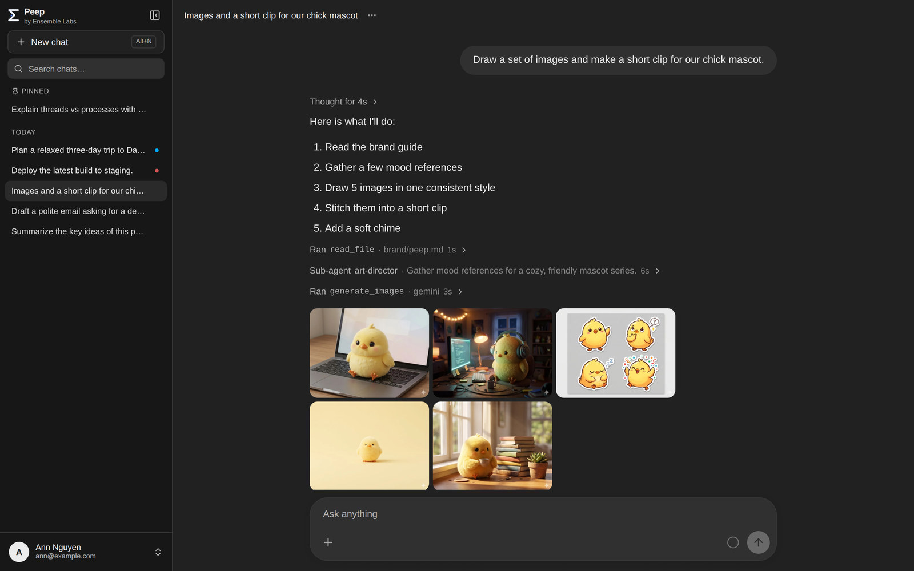</p>

<p align="center"><sub><i>Một lượt chạy agent trực tiếp: suy nghĩ, kế hoạch, công cụ, sub-agent và ảnh được tạo ra. Ảnh demo do Gemini tạo.</i></sub></p>

## Xem Peep hoạt động

<table>
<tr>
<td width="50%" valign="top">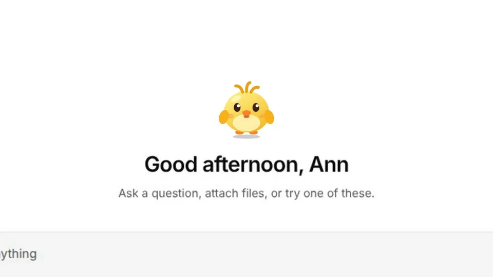<br><b>Peep chào bạn</b><br><sub>Mở chat mới là Peep ra chào, rồi ở lại bầu bạn.</sub></td>
<td width="50%" valign="top">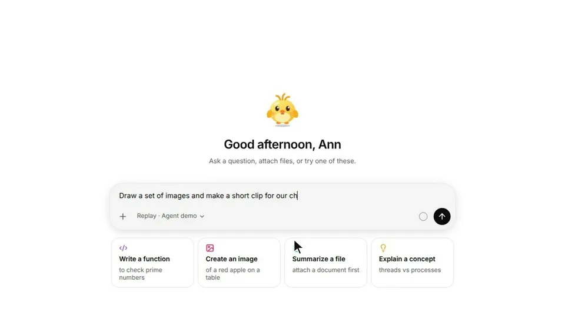<br><b>Suy nghĩ trực tiếp</b><br><sub>Thấy agent suy nghĩ ngay lúc đó, xong tự thu gọn.</sub></td>
</tr>
<tr>
<td width="50%" valign="top">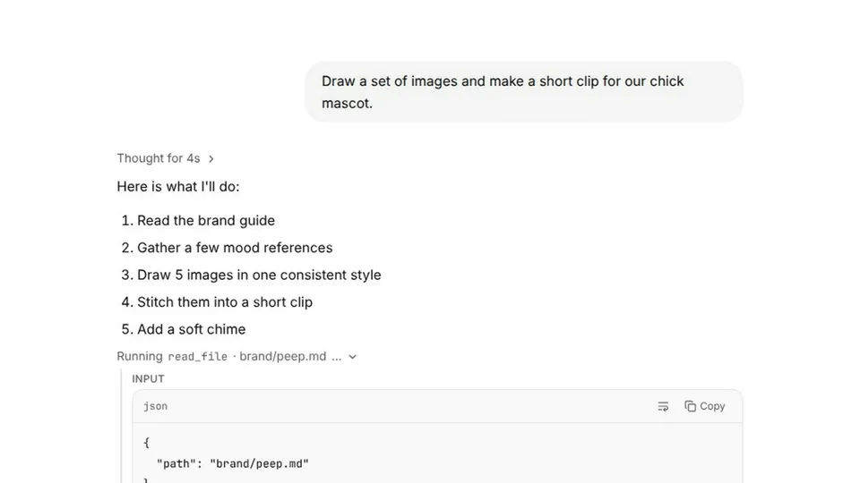<br><b>Tool, sub-agent, hình ảnh</b><br><sub>Từng bước agent làm, rồi tới kết quả.</sub></td>
<td width="50%" valign="top">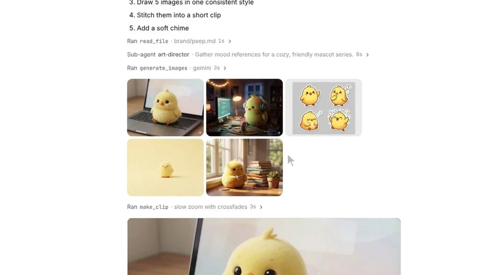<br><b>Lightbox và video</b><br><sub>Phóng to, phát, tua, tải xuống.</sub></td>
</tr>
<tr>
<td width="50%" valign="top">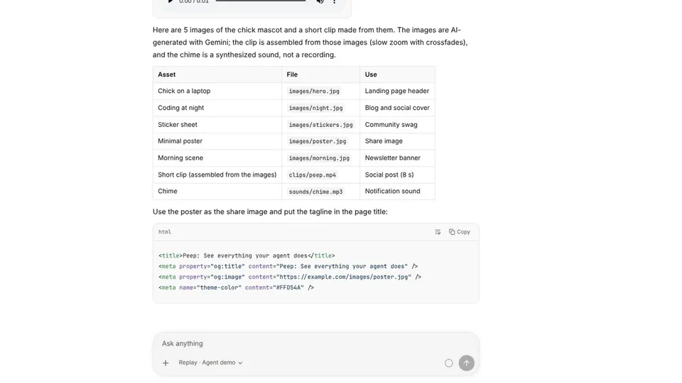<br><b>Vòng context</b><br><sub>Biết context đang chứa những gì.</sub></td>
<td width="50%" valign="top">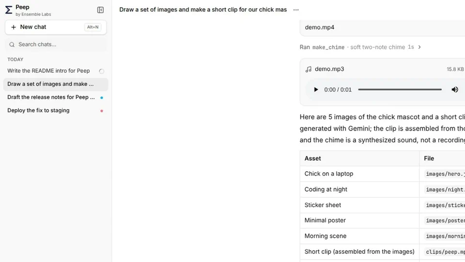<br><b>Trạng thái chat, sáng hay tối</b><br><sub>Chat đang chạy, chưa đọc, bị lỗi; một chạm là sang dark mode.</sub></td>
</tr>
<tr>
<td align="center" valign="top">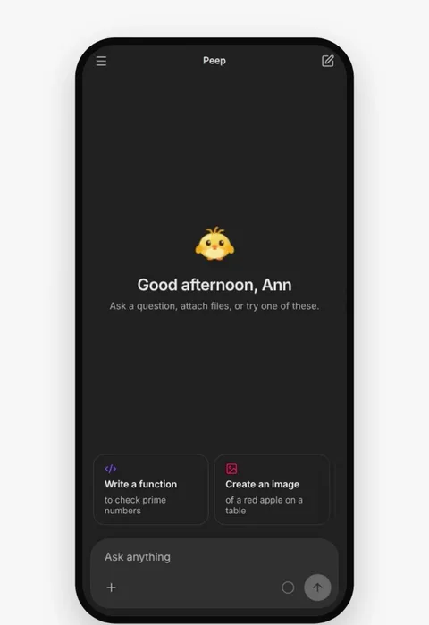<br><b>Trên điện thoại</b><br><sub>Trải nghiệm y như trên máy tính.</sub></td>
<td align="center" valign="top">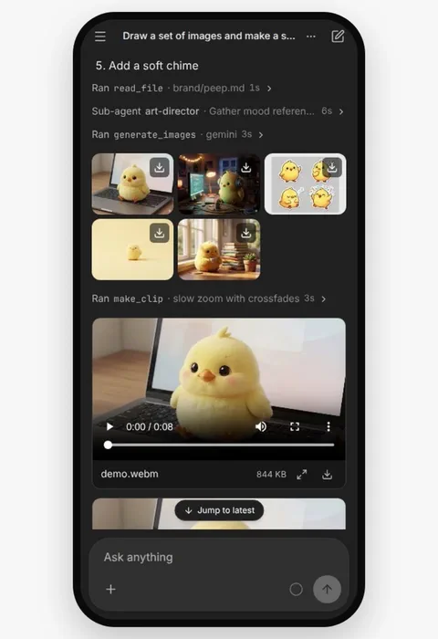<br><b>Gallery và drawer trên mobile</b><br><sub>Chạm, vuốt, đổi cuộc chat.</sub></td>
</tr>
</table>

## Quản lý tài khoản

Peep có tài khoản thật cho cả nhóm, kèm trang quản trị để điều hành. Admin duyệt người tự đăng ký, hoặc tự tạo tài
khoản rồi gửi mật khẩu tạm cho họ, và quản lý mọi người trên một trang dùng được cả trên điện thoại. Mọi thay đổi của
admin đều được ghi vào nhật ký, và mỗi người dùng có thể có hạn mức token. Hướng dẫn đầy đủ nằm ở
[docs/usage.md](docs/usage.md#account-management).

- Tạo tài khoản (hoạt động ngay hoặc chờ duyệt), duyệt, vô hiệu hoá, kích hoạt lại hoặc xoá nhiều người cùng lúc.
  Tài khoản của chính bạn được bỏ qua.
- Cấp hoặc gỡ quyền quản trị, đặt lại mật khẩu, vô hiệu hoá một người (phiên bị huỷ, dữ liệu vẫn còn) hoặc xoá họ cùng
  tệp.
- Đặt hạn mức token cho từng người, theo ngày hoặc theo tháng (giờ UTC), kiểm tra trước khi gửi tin. Mặc định không
  giới hạn.
- Người dùng xem mức đã dùng trong menu tài khoản; khi chạm hạn mức, khung soạn tin cho biết lúc nào được đặt lại.
- Tab nhật ký cho biết ai đã làm gì với ai, có tìm kiếm và lọc theo hành động.

<table>
<tr>
<td width="50%" valign="top">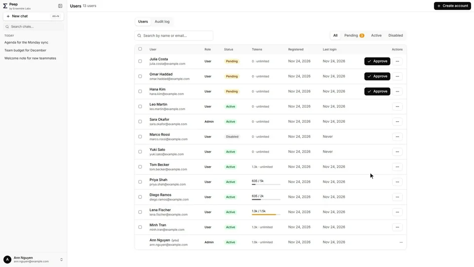<br><b>Tạo và duyệt</b><br><sub>Tạo tài khoản, duyệt cả loạt.</sub></td>
<td width="50%" valign="top">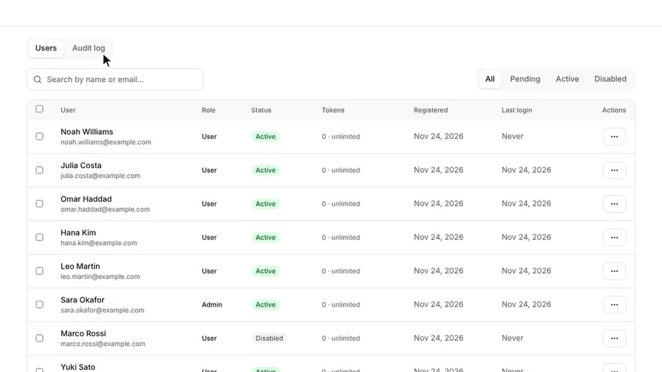<br><b>Nhật ký</b><br><sub>Ai đã đổi gì, vào lúc nào.</sub></td>
</tr>
<tr>
<td width="50%" valign="top">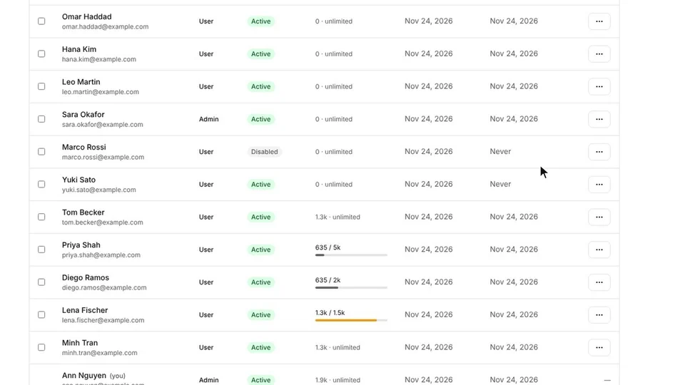<br><b>Hạn mức token</b><br><sub>Đặt hạn mức; người dùng bị chặn khi chạm trần.</sub></td>
<td align="center" valign="top">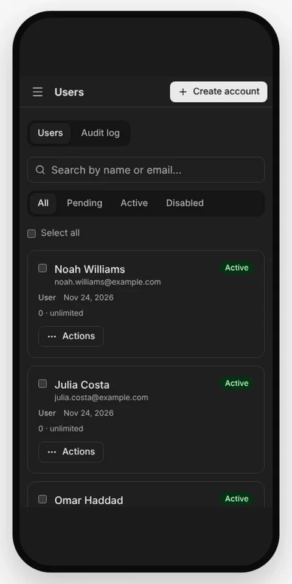<br><b>Quản trị trên điện thoại</b><br><sub>Cùng trang quản trị, trên mobile.</sub></td>
</tr>
</table>

## Peep là gì

Peep là ứng dụng chat tự host, cho bạn thấy toàn bộ quá trình agent làm việc chứ không chỉ câu trả lời cuối: phần suy
nghĩ, các lần gọi công cụ, sub-agent, ảnh, video, âm thanh và mức dùng context, tất cả hiện dần theo thời gian thực.
Peep chạy với mọi API chat tương thích OpenAI (OpenAI, Gemini, DeepSeek, Anthropic compat, OpenRouter, vLLM, Ollama
và các dịch vụ khác). Hiện Peep mới là phần giao diện, chưa có logic agent riêng; kèm theo là các lượt chạy mẫu đã ghi
sẵn để bạn xem đủ mọi thành phần mà không cần model.

## Điểm nổi bật

**Hội thoại**
- Phần suy nghĩ chảy vào một dòng gọn rồi thu lại thành "Thought for 12s". Lệnh gọi công cụ và sub-agent lồng nhau
  hiện thành từng dòng, xem được đầu vào và đầu ra; ảnh, video, âm thanh hiện ngay trong mạch trả lời.
- Markdown, code có tô màu và nút Copy, công thức toán LaTeX.
- Mức suy nghĩ riêng cho từng model (Off, Low, High, ...) khai báo trong cấu hình, nút Dừng, và câu trả lời vẫn chạy tiếp
  nếu bạn đóng tab.
- Đính kèm ảnh, video, âm thanh và tệp; xem ảnh trong lightbox có phóng to.
- Phần demo trong ảnh chụp dùng sản phẩm AI thật: các bức ảnh do Gemini tạo ra, còn đoạn clip ngắn được ghép từ chính
  những bức ảnh đó.

**Luôn biết tình hình**
- Đồng hồ context cho biết đã dùng bao nhiêu phần cửa sổ context của model, kèm chi tiết và số token cache.
- Thanh bên cho biết cuộc chat nào đang chạy, chưa đọc hay bị lỗi; có tìm kiếm và ghim.

**Tài khoản an toàn**
- Tài khoản bằng email và mật khẩu. Tài khoản mới phải chờ admin duyệt, hoặc do admin tạo trực tiếp. Có sẵn thao tác
  hàng loạt, nhật ký và hạn mức token tuỳ chọn cho từng người.
- Trang Plugins & Skills: mỗi người dùng lưu các MCP server và gói skill cho agent sau này (chat hiện chưa dùng đến).
  Thông tin bí mật của plugin được mã hoá khi lưu.

**Mọi nơi, mọi thiết bị**
- Điện thoại, máy tính bảng, máy tính để bàn; cài được như một PWA.
- Tiếng Việt và tiếng Anh, giao diện sáng và tối.
- Peep, chú gà con màu vàng, chào bạn khi mở cuộc chat mới và ở bên cạnh trong lúc chờ câu trả lời.

## Bắt đầu nhanh

Bạn cần Docker với Compose v2.

```bash
git clone git@github.com:ensemlabs/peep.git && cd peep
make env
```

1. `make env` tạo `.env` với các khoá bí mật sinh ngẫu nhiên (cơ sở dữ liệu, MinIO, mật khẩu admin, `SECRETS_KEY`) và
   `config/models.yaml` từ file mẫu; không bao giờ ghi đè `.env` có sẵn. Tài khoản admin là `ADMIN_EMAIL` và
   `ADMIN_PASSWORD` trong `.env` (hãy đổi `ADMIN_EMAIL` thành địa chỉ của bạn trước). Hãy giữ `SECRETS_KEY`: mất khoá
   thì không đọc lại được các header plugin đã lưu. Ở chế độ production, Peep từ chối khởi động nếu còn mật khẩu
   mang giá trị mẫu `change-me`.
2. Sửa `config/models.yaml`: trỏ `active` tới một model của nhà cung cấp bạn dùng (trong file có sẵn các mẫu để chép),
   rồi điền API key của nhà cung cấp vào `.env` theo đúng tên biến ghi ở `api_key_env`.
3. Khởi động:

   ```bash
   make up
   ```

4. Mở http://127.0.0.1:8090 và đăng nhập bằng `ADMIN_EMAIL` và `ADMIN_PASSWORD`.

`make up` cũng tự tạo hai file trên nếu còn thiếu. Sau khi sửa `config/models.yaml`, chạy `docker compose restart app`.
Các lượt chạy mẫu `replay:*` có sẵn không cần nhà cung cấp nào (xem [docs/usage.md](docs/usage.md)).

### Chạy image dựng sẵn

Muốn bỏ qua bước build, dùng image duy nhất `ghcr.io/ensemlabs/peep` đã đăng trên GHCR (`linux/amd64` và `linux/arm64`). Chuẩn bị `.env` và
`config/models.yaml` như trên, rồi:

```bash
docker compose -f docker-compose.yml -f docker-compose.ghcr.yml up -d
```

Mặc định kéo bản `latest`; đặt `PEEP_VERSION=0.1.0` (trong `.env` hoặc shell) để cố định một bản phát hành. Cần Compose 2.24 trở lên.

## Cấu hình

Peep đọc danh sách model từ `config/models.yaml`. Người dùng dùng model `active`:

```yaml
active: my-model
providers:
  - id: my-provider
    base_url: https://api.example.com/v1
    api_key_env: MY_PROVIDER_API_KEY   # tên biến trong .env; không ghi key vào file này
    models:
      - id: my-model
        upstream: provider-model-name
        context_window: 128000
        thinking:                       # không bắt buộc
          default: "off"
          levels:
            - {id: "off",  label: Off, patch: {}}
            - {id: high, label: High, patch: {reasoning_effort: high}}
```

[`config/models.example.yaml`](config/models.example.yaml) có sẵn mẫu cho OpenAI, Gemini, DeepSeek, Anthropic compat,
OpenRouter và vLLM/Ollama. Cài đặt của các nhà cung cấp hay thay đổi, nên hãy đối chiếu từng mẫu với tài liệu hiện hành
của họ.

Các biến bạn có thể sẽ cần chỉnh:

| Biến | Mặc định | Ý nghĩa |
| :--- | :--- | :--- |
| `ADMIN_EMAIL`, `ADMIN_PASSWORD` | trống | Admin đầu tiên, tạo khi khởi động |
| `SECRETS_KEY` | trống | Khoá Fernet cho thông tin bí mật của plugin |
| `APP_ORIGINS` | `http://localhost:8090,http://127.0.0.1:8090` | Các origin được phép; thêm địa chỉ công khai của bạn |
| `COOKIE_SECURE` | `auto` | `auto`: cookie Secure (tên `__Host-ec_session`) khi mọi mục trong `APP_ORIGINS` là https; hoặc `true` / `false` |
| `WEB_PORT` | `8090` | Cổng trên máy chủ, chỉ mở ở `127.0.0.1` |
| `MAX_UPLOAD_MB` | `200` | Giới hạn dung lượng tải lên |
| `MODELS_CONFIG` | `/app/config/models.yaml` | Đường dẫn file model trong container |

Phần còn lại (phiên đăng nhập, giới hạn đăng nhập, S3, replay): [docs/configuration.md](docs/configuration.md)
(viết bằng tiếng Anh).

### Chạy sau reverse proxy

Peep phục vụ HTTP thường. Với site công khai, hãy kết thúc TLS ở một proxy (Caddy, Traefik, nginx), đặt
`APP_ORIGINS` (https) hoặc `COOKIE_SECURE=true`, thêm URL công khai vào `APP_ORIGINS` và đặt `TRUSTED_PROXIES` là địa chỉ của proxy để lấy đúng IP
client (mặc định để trống: bỏ qua `X-Forwarded-For`). Tắt buffering của proxy cho `/api` để SSE chảy liên tục. Xem
[docs/architecture.md](docs/architecture.md#running-behind-a-reverse-proxy).

Một số tên nội bộ vẫn giữ tên cũ của dự án: project Docker Compose, cơ sở dữ liệu và bucket là `ensemble-chat` /
`ensemble_chat`, cookie phiên là `ec_session` (`__Host-ec_session` qua https), còn cài đặt trên trình duyệt lưu trong `localStorage` với khoá `ec_*`.

## Kiến trúc

```
trình duyệt ── app (FastAPI: giao diện SPA + /api, một worker, cổng duy nhất được mở ra ngoài)
                  ├── postgres   người dùng, chat, tin nhắn, plugin, skill
                  ├── minio      tệp tải lên và tệp được tạo ra (S3)
                  └── LLM        mọi endpoint tương thích OpenAI
```

Chi tiết và luồng xử lý: [docs/architecture.md](docs/architecture.md). Hợp đồng HTTP và SSE:
[docs/api.md](docs/api.md). Vì sao chọn bộ công nghệ này: [ADR 0001](docs/adr/0001-tech-stack.md). (Các tài liệu này
viết bằng tiếng Anh.)

## Phát triển và kiểm thử

| Lệnh | Tác dụng |
| :--- | :--- |
| `make up` / `make down` | Bật và tắt hệ thống |
| `make logs`, `make ps`, `make build` | Xem log, trạng thái, build image |
| `make test-be` | Test backend trên Postgres và MinIO thật |
| `make test-fe` | Test frontend, kiểm tra kiểu và build |
| `make e2e` | Chạy bộ test Playwright trên hệ thống đang chạy |
| `make clean` | Tắt và xoá toàn bộ dữ liệu |

`make help` liệt kê đầy đủ. Xem thêm [docs/development.md](docs/development.md).

## Bảo mật

- Mật khẩu băm bằng argon2id. Phiên đăng nhập là token ngẫu nhiên trong cookie `HttpOnly`, `SameSite=Lax`; hệ thống
  chỉ lưu bản băm. Các yêu cầu thay đổi dữ liệu phải đến từ origin được phép (chống CSRF).
- Giới hạn đăng nhập: sai 5 lần thì khoá cặp email và IP đó 15 phút, mỗi lần khoá sau gấp đôi, tối đa 24 giờ.
- Chỉ chủ sở hữu mới đọc được tệp của mình. Chỉ ảnh, video, âm thanh đã kiểm tra mới hiển thị trực tiếp; các loại khác
  chỉ cho tải về, kèm `nosniff` và CSP chặt.
- Header của plugin được mã hoá khi lưu (Fernet) và không bao giờ trả lại nguyên văn. Peep không gọi tới URL của plugin
  và không chạy mã trong skill.
- Đừng bao giờ commit `.env` hay `config/models.yaml`.

Chi tiết và con số: [docs/configuration.md](docs/configuration.md) và [docs/api.md](docs/api.md#auth).

## Lộ trình và hạn chế

- Peep chạy một worker API: các câu trả lời nằm trong tiến trình, nên khi khởi động lại, những câu đang chạy bị đánh dấu
  là bị gián đoạn. Muốn mở rộng cần một kênh sự kiện dùng chung.
- Plugins và Skills mới chỉ được lưu, chat chưa dùng: bước tiếp theo là nối với một agent backend thật.
- Chưa có SSO, xác minh email, email mời hay email đặt lại mật khẩu; admin đặt lại mật khẩu và gửi mật khẩu tạm.
- Tệp tải lên chưa được quét virus và chưa có hạn mức dung lượng theo người dùng (hạn mức token chỉ tính token của
  model).
- PWA chưa có service worker, nên chưa dùng được khi ngoại tuyến.

## Giấy phép

MIT, xem [LICENSE](LICENSE). © 2026 Ensemble Labs.
